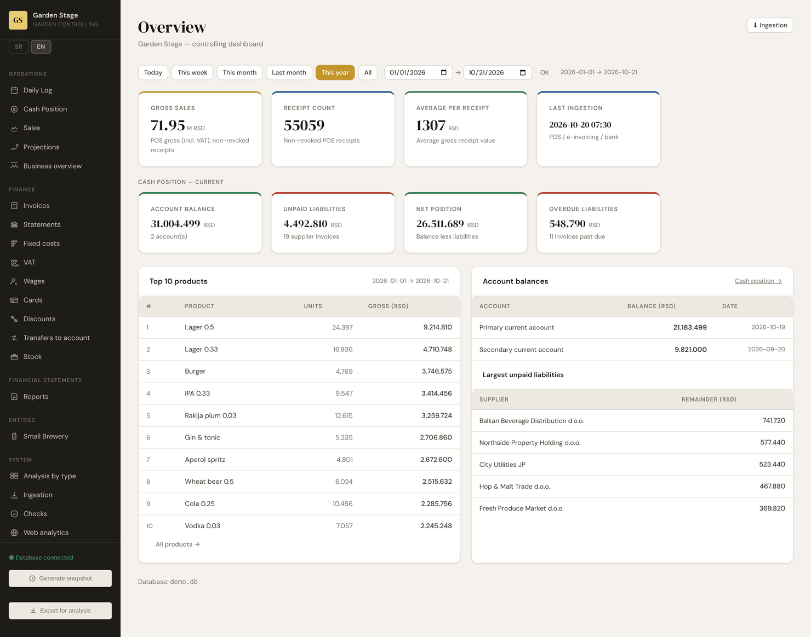
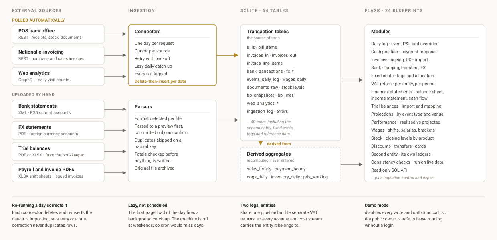

# Controlling System

A modular controlling and business intelligence system: automated ingestion,
reconciliation, VAT and financial reporting. Demonstrated here on a multi-venue
hospitality operation; the architecture is domain-agnostic.

Built to replace 29 Excel workbooks and a set of Power BI dashboards that had
stopped being trustworthy. Everything in this repository runs on generated
demo data — no real business figures are included.



---

## The problem

A small group ran two venues and a brewery through spreadsheets. Sales came out
of the point-of-sale back office, purchases arrived through the national
e-invoicing platform, money moved through two banks in two formats, and payroll
was a spreadsheet someone emailed over. Each of those was reconciled by hand
into a workbook, and the workbooks fed each other.

The failure mode was not that it was slow, though it was. It was that nobody
could say whether a number was right. A VAT figure was the end of a chain of
copy-paste with no audit trail, and when two reports disagreed there was no way
to find out which one had drifted.

This system replaces the chain with one database that every figure is derived
from, and a set of checks that fail loudly when a derivation stops holding.

## Architecture



Seven sources reach the system two ways. Three are polled by connectors that
are idempotent per date: each run deletes and reinserts the day it is
importing, so re-running a day corrects it rather than duplicating it. The
other four arrive as files — bank statements, trial balances from the
bookkeeper, payroll sheets and issued invoices — and are parsed into a preview
that is only committed once the totals check out.

Both paths write to transaction-level tables, which are the source of truth.
Every aggregate the dashboard reads is recomputed from them rather than
entered. Two legal entities share the pipeline but file separate VAT returns,
so every stream carries the entity it belongs to.

## What it does

| Module | What it covers |
| --- | --- |
| **Daily log** | Per-event P&L: takings, cost of sales, wages, fees and fixed-cost allocation, with manual overrides kept separate from derived figures |
| **Cash position** | Bank balances against outstanding payables and receivables, with a payment proposal that exports to PDF |
| **Invoices** | Purchase and sales ledgers from the e-invoicing platform, with ageing, payment logging and PDF import for invoices issued outside it |
| **Bank** | Statement import (XML and PDF), transaction tagging, internal-transfer detection and a foreign-currency sub-ledger |
| **Fixed costs** | Monthly cost and income items, tagged and allocated across events |
| **VAT** | The return computed from the invoice ledger and the fiscal receipts, per entity, per period |
| **Financial statements** | Balance sheet, income statement and an indirect cash flow built from imported trial balances, with estimates for interim periods |
| **Projections** | Forward event projections from trailing twelve-month averages by event type and venue |
| **Performance** | Realised results by period and event type, with year-on-year comparison |
| **Stock, wages, discounts, cards** | Closing stock levels, shift wages with tax brackets, discounted receipts, company card spend |
| **Checks** | Invariants that must hold across modules, each added after something specific went wrong |

Full screenshots are in [`docs/screenshots/`](docs/screenshots). Each one is
a single screen rather than the whole scroll, on a window wide enough that
the data tables are in frame; at a normal window width the widest of them
scroll inside their card.

## Running it

Requires Python 3.11 or newer.

```bash
pip install -r flask_app/requirements.txt
cp config.example.py config.py

python -m demo_data.generate       # builds demo.db (~16s, 99 MB)
python -m demo_data.verify demo.db # 40 consistency checks

cd flask_app && python app.py      # http://localhost:5000
```

`--scale 0.3` builds a smaller, faster database if you only want to click
around. The generator is deterministic: the same seed always produces the same
database, so screenshots, tests and a hosted demo all agree.

## The demo data

There is no anonymised real data here. `demo_data/` generates the whole dataset
from a catalogue of invented venues, products, staff, suppliers and customers.

| | |
| --- | --- |
| Period | April 2025 – October 2026 |
| POS receipts / lines | 107,735 / 287,009 |
| Events | 925 |
| Purchase / sales invoices | 844 / 335 |
| Bank transactions | 2,996 |
| Shift wage records | 5,561 |
| Tables populated | 64 |

It is generated in dependency order rather than table by table. `plan.py` first
builds a day-by-day operating plan — which venue was open, what was booked, how
busy it was — and sales, wages, purchases and cash all derive from that. The
result behaves like a real seasonal business: the outdoor venue takes 13.2M RSD
in July against 1.9M in February, gross margin sits near 64%, and cash dips to
a tight winter trough that the projections module exists to anticipate.

`demo_data/verify.py` asserts that the generated data holds together — bills
tie to their lines, aggregates tie to the transactions beneath them, VAT ties
to the invoice ledger, the balance ledger reconciles to its movements. It
catches generator drift that would otherwise produce a plausible-looking demo
whose numbers quietly disagree.

## Notes on the engineering

**Ingestion is idempotent and resumable.** Each connector keeps a cursor and
imports one day at a time, deleting and reinserting that date. A failed run is
retried on the next one; a corrected day overwrites cleanly. Every run is
logged with counts and errors.

**Ingestion is lazy, not scheduled.** The first page load of each day fires a
background catch-up from the last ingested date. A cron job was the obvious
choice and the wrong one — the machine is off at weekends, so scheduled runs
would silently miss days.

**The analytics connector asks for one day at a time on purpose.** Past about
seven days the upstream API switches to a 1:10 sampled dataset without scaling
the counts back up, so a wide query understates traffic by roughly 4×. Bot
traffic is stored as a flag rather than filtered on import, so it can be
included or excluded in the UI without re-ingesting.

**Aggregates are derived, never entered.** `sales_hourly`, `cogs_daily`,
`inventory_daily` and `pdv_working` are recomputed from the transaction tables.
Where a figure can be overridden by hand — an event's wages, say — the derived
value and the override are stored in separate columns, so the system can always
show what it calculated and what a person changed it to.

**Consistency checks are a module, not a test suite.** Each one was added
because something concrete went wrong: VAT streams misattributed across years
by a `GROUP BY` alias collision, cancelled invoices inflating input VAT,
entity-blind income links mixing the two companies. They run against live data
and are visible in the UI.

**Demo mode** disables every write and outbound API call, so a public demo can
be left running without a login.

## Bilingual UI

The interface runs in Serbian and English, switched from the sidebar and kept
in the session. The Serbian source string is the lookup key, the way gettext
uses the source language as the message id: there are no key names to keep in
sync with the templates, and a string with no translation yet falls back to
Serbian rather than rendering blank. The catalogue holds 1,703
entries in `translations.py`.

Coverage is checked three ways over every route, in English: a diacritic
anywhere in the page is decisive, a segment that is itself a key in the
Serbian catalogue is untranslated, and a word that belongs to the Serbian
vocabulary but not to the English one catches the plain-Latin cases —
"Januar", "Stopa", "Konobar" — that a diacritic test cannot see. Names
stored in the demo database are subtracted, since a supplier is a supplier
in both languages. The check currently reports no untranslated segments on
any of the 61 routes. Month and day names resolve through `i18n.py` rather
than the per-blueprint constants they used to live in, so they follow the
active language too.

## Layout

```
flask_app/            Flask application
  app.py                entry point, blueprint registration
  i18n.py               language resolution and the tr() helper
  blueprints/           24 modules, one per area
  templates/            60 Jinja templates
  static/
demo_data/            synthetic data generator
  catalog.py            invented venues, products, staff, suppliers
  plan.py               the day-by-day operating plan everything derives from
  gen_*.py              per-domain generators
  verify.py             consistency checks over the generated database
schema.sql            database structure, no data
translations.py       Serbian to English UI catalogue
config.example.py     configuration template; copy to config.py
pdv_lib.py            VAT calculation helpers
```

About 32,000 lines across Python, Jinja, CSS and JavaScript.

## What is not here

- **Credentials and endpoints.** `config.py` is git-ignored; every secret is
  read from the environment and defaults to empty. The connectors are included
  and readable, but will not reach anything without configuration.
- **Real data.** No figures, names, suppliers, employees or account numbers
  from the business this was built for.
- **Tests.** There is no unit test suite. Correctness is enforced by the
  consistency checks and the generator's verifier, which is honest about what
  it is: a system built by one person against live data, where an invariant
  that fails on real numbers was worth more than a mock that passes.

## License

All rights reserved — see [LICENSE](LICENSE). The code is published to be
read, not reused: you may read it and run it locally against the generated
demo data to assess the work, and anything beyond that needs permission.
