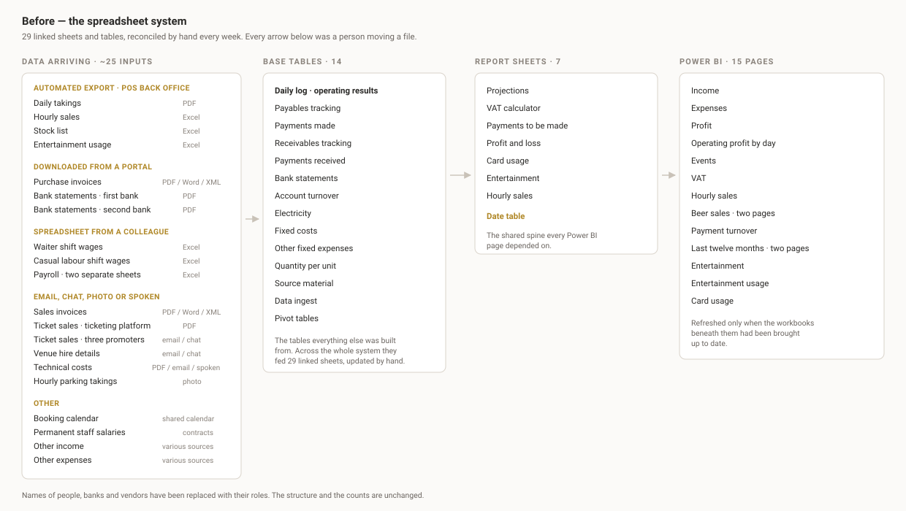

# Controlling System

An in-house financial controlling and reporting system, designed and built from
scratch for the company I developed it for. It collects data from every system
the business runs on, reconciles it into a single database, and produces the
reporting that was previously assembled by hand each week.

The design is deliberately modular. The business it was built for is a
multi-venue hospitality and events operation, which shapes the examples
throughout, but little of the structure is specific to that trade. Sources,
entities, cost categories and reporting periods are all configurable. What is
fixed is the principle underneath: every figure traces back to a transaction,
and nothing is entered into the system twice.


---

## The business

An operation built around events rather than fixed rooms. The venues are
reconfigured to suit whatever has been booked — a concert one night, a
conference the next, an ordinary trading day in between — and a brewery branch
operates independently within the same group.

That flexibility is why controlling matters here. When no two events share a
shape, monthly averages hide more than they reveal. The only way to know which
kinds of events are worth running is to cost each one on its own: its takings,
its stock, its wages, its share of the fixed costs.

## The problem

There was no reporting system in place at the start. The first one I built ran
on Excel and Power BI — 29 separate sheets and tables feeding each other,
reconciled by hand every week. It did the job, and the business ran on it.

Four systems supply the numbers. Sales come from the point-of-sale back office,
purchases arrive through the national e-invoicing platform, money moves through
two banks in two different file formats, and payroll arrives as a spreadsheet.
Each had to be exported, cleaned and reconciled by hand before any question
could be answered.

The limit was volume rather than effort. As the number of events and sources
grew, so did the reconciliation, and all of it fell to one person alongside the
finance role it supports. More time went into assembling the figures than into
reading them, and every manual step was somewhere an error could enter without
anyone noticing it had.

This system is the next step from that. The same reporting and the same
definitions, but the collection and reconciliation happen on their own, and
every figure is derived from one database rather than copied between workbooks.

## What it does

| Module | What it covers |
| --- | --- |
| **Daily log** | Per-event P&L: takings, cost of sales, wages, fees and fixed-cost allocation, with manual corrections kept separate from calculated figures |
| **Cash position** | Bank balances against outstanding payables and receivables, with a payment proposal that exports to PDF |
| **Invoices** | Purchase and sales ledgers from the e-invoicing platform, with ageing, payment logging and PDF import for invoices issued outside it |
| **Bank** | Statement import, transaction tagging, internal-transfer detection and a foreign-currency sub-ledger |
| **Fixed costs** | Monthly cost and income items, tagged and allocated across events |
| **VAT** | The return calculated from the invoice ledger and the fiscal receipts, per entity, per period |
| **Financial statements** | Balance sheet, income statement and an indirect cash flow built from imported trial balances, with estimates for interim periods |
| **Projections** | Forward projections by event type and venue, from trailing twelve-month averages |
| **Performance** | Realised results by period and event type, with year-on-year comparison |
| **Stock, wages, discounts, cards** | Closing stock levels, shift wages with tax brackets, discounted receipts, company card spend |
| **Checks** | Rules that have to hold true across the whole system, each one added after a specific mistake got through |

The interface runs in Serbian and English, switched from the sidebar.

Screenshots of every module are in [`docs/screenshots/`](docs/screenshots).

## What changed

Reporting runs weekly: each Monday covers the week before.

Under the Excel system, producing that report took roughly three working days,
depending on how busy the week had been. It now takes about three hours. The
collecting and reconciling happen on their own; what is left is the actual
work of turning what the system has gathered into a report that makes sense.

Figures that used to be put together once a week are now available whenever
they are needed.

---

# Technical detail

## How it works

The system this replaced looked like the diagram below: around twenty-five
separate inputs arriving by export, portal download, email, chat and
photograph, reconciled by hand into linked workbooks that fed the report
sheets and the dashboards above them.



The current system collects the same information from the same places. The
difference is that the collecting and the reconciling are now the system's
job.


Seven sources feed the system, two different ways.

Three are collected automatically: the point-of-sale back office, the national
e-invoicing platform and the website analytics are polled once a day. The other
four arrive as files — bank statements, trial balances from the bookkeeper,
payroll sheets and invoices issued outside the e-invoicing platform. Those are
uploaded, checked against their own totals, and only committed once they
balance.

Everything lands in transaction-level tables: individual receipts, individual
invoice lines, individual bank movements. Every figure the dashboard shows is
calculated from those tables when the page is opened, rather than stored as a
number somebody typed. That is the whole design: a fact lives in exactly one
place, and everything else is derived from it.

Two legal entities share the system but file separate VAT returns, so every
record carries the entity it belongs to.

## Design decisions

These are the rules the system was built around, and the reasoning behind
each.

**Nothing is entered twice.** Every figure on screen is worked out from the
underlying records each time a page is opened. Correct a receipt or an invoice
and every report that uses it changes with it. Under the old system the same
number lived in four workbooks and they drifted apart.

**Corrections sit beside the calculation, never on top of it.** Some figures
have to be adjusted by hand — a wage that was settled differently, a cost that
belongs to a different event. The adjusted value and the original calculated
value are kept separately, so the system can always show both. Without that,
nobody can answer why a number moved.

**Re-importing a day replaces it.** If a day came in wrong or incomplete,
importing it again overwrites what was there rather than adding to it. This
was a requirement rather than a nicety: under the old system, a double import
meant hunting for duplicate rows by hand.

**The checks are there because of specific mistakes.** Each one was added after
a real error got through — VAT attributed to the wrong year, cancelled invoices
still counted, figures from the two companies mixed together. They run against
live data and sit in the interface where they can be seen, rather than in a
test suite that only runs when someone remembers to run it.

**The published demo cannot be changed or used to reach anything.** It runs
with saving switched off and with every outside connection disabled: a visitor
can open every page and alter nothing, and the system will not attempt to
contact the POS back office, the e-invoicing platform or the banks. That is
what makes it safe to leave online without a password.

## The demo data

Nothing here is anonymised real data. `demo_data/` generates the entire dataset
from a catalogue of invented venues, products, staff, suppliers and customers.

| | |
| --- | --- |
| Period | April 2025 – October 2026 |
| POS receipts / lines | 107,735 / 287,009 |
| Events | 925 |
| Purchase / sales invoices | 844 / 335 |
| Bank transactions | 2,996 |
| Shift wage records | 5,561 |
| Tables populated | 64 |

The generator does not fill the tables one by one. It starts by inventing a
calendar — which venue was open on which day, what was booked, how busy it
was — and then produces the receipts, wages, purchases and bank movements that
such a day would actually have produced. Doing it in that order is what makes
the numbers agree with each other the way real ones do.

The result behaves like a real seasonal business, with a summer peak roughly
seven times the February trough and a winter cash dip that the projections
module exists to anticipate.

A verification script then re-checks the result: 40 checks confirming that
receipts add up to their lines, that totals match the records beneath them,
and that the VAT figures match the invoices.

## Running it

Requires Python 3.11 or newer.

```bash
pip install -r flask_app/requirements.txt
cp config.example.py config.py

python -m demo_data.generate       # builds demo.db (~16s, 99 MB)
python -m demo_data.verify demo.db # 40 consistency checks

cd flask_app && python app.py      # http://localhost:5000
```

`--scale 0.3` builds a smaller, faster database if you only want to click
around. The generator is deterministic, so the same seed always produces the
same database.

`config.py` is git-ignored and every credential is read from the environment.
The connectors are included and readable, but reach nothing without
configuration.

## Layout

```
flask_app/            Flask application
  app.py                entry point, blueprint registration
  i18n.py               language resolution and the tr() helper
  blueprints/           24 modules, one per area
  templates/            60 Jinja templates
  static/
demo_data/            synthetic data generator
  catalog.py            invented venues, products, staff, suppliers
  plan.py               the day-by-day operating plan everything derives from
  gen_*.py              per-domain generators
  verify.py             consistency checks over the generated database
schema.sql            database structure, no data
translations.py       Serbian to English UI catalogue
config.example.py     configuration template; copy to config.py
pdv_lib.py            VAT calculation helpers
```

About 32,000 lines across Python, Jinja, CSS and JavaScript.

## License

All rights reserved — see [LICENSE](LICENSE). The code is published to be read,
not reused: you may read it and run it locally against the generated demo data
to assess the work, and anything beyond that needs permission.
